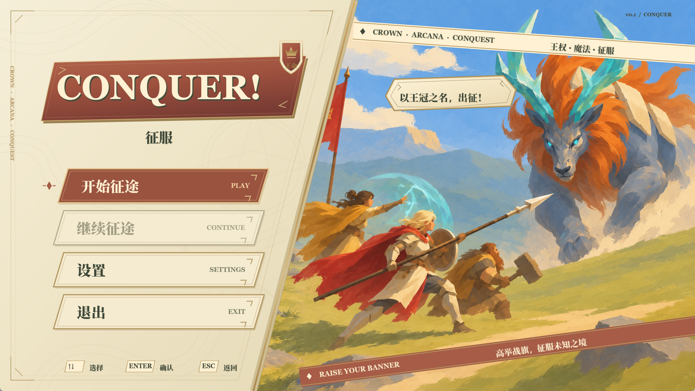
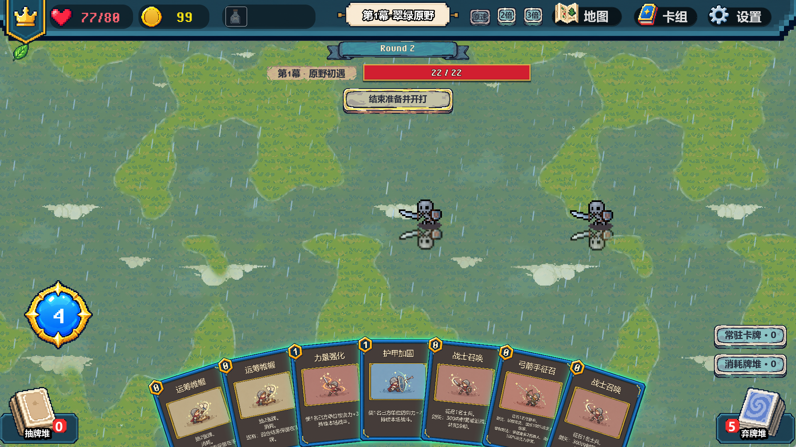
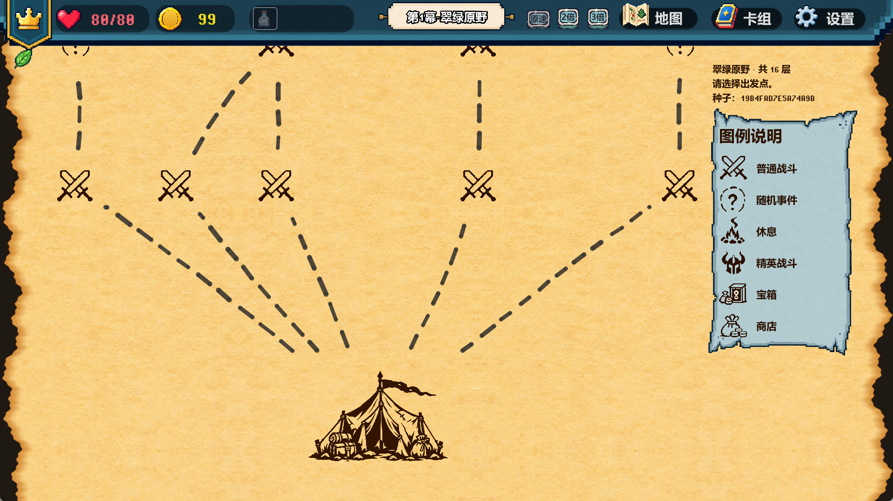
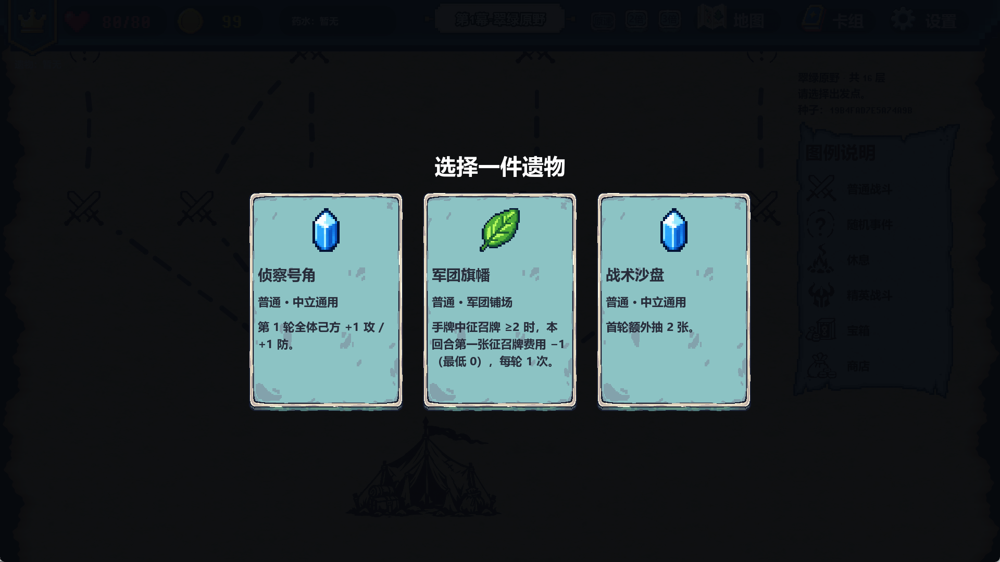

# CONQUER! 征服 · 卡牌构筑战棋 Roguelike

> 一款用 Godot 4.6 做的单机策略游戏：卡牌构筑 + 战棋部署 + Roguelike 路线。
> 44 兵种 · 61 卡牌 · 66 遗物 · 40 药水 · 20 路线事件 · 16 层章节



---

## 这是什么

每局从 16 层路线上选择节点前进（战斗 / 精英 / 事件 / 商店 / 休息 / 宝箱）。进入战斗后先在准备阶段用手牌部署单位、施放效果，再进入回合制自动战斗；战斗胜利获得卡牌、遗物与药水，逐步构筑出这一局的解法。

项目目标不是做一个「能跑的原型」，而是把**设计、数值、内容生产工具**三件事都做完整：所有兵种、卡牌、遗物、药水、事件与路线都来自可编辑的配置表，配套自研的 Godot 编辑器插件来批量生产内容。

| 战斗 | 路线 |
|---|---|
|  |  |

| 开局遗物三选一 |
|---|
|  |

---

## 玩法与系统

- **卡牌构筑**：征召牌生成单位，效果牌提供增益 / 伤害 / 控制；遗物改变规则，药水提供一次性解法。
- **战棋部署**：按费用在己方半场部署单位，射程、阻挡、飞行与地形共同决定站位价值。
- **路线 Roguelike**：16 层固定路线 + 分支选择，商店、营地、随机事件穿插在战斗之间。
- **地形与天气**：四层地形与桥梁、楼梯位移攻击（扑击 / 冲锋 / 跳砸可切层）、雨雪天气影响表现与战场氛围。
- **飞行单位**：可跨越墙体、水面与断路，不依赖寻路与楼梯。
- **图鉴与存档**：书本翻页式图鉴、暂停菜单、保存并退出、继续征途。

---

## 工程与工具链

这部分是这个项目里我最想展示的东西——**内容量不是手搓出来的，是用工具批量生产的**：

| 工具 | 作用 |
|---|---|
| 地图工坊 | 可视化编辑固定路线、分叉、战斗关卡与事件奖励，可试玩并导出 JSON |
| 波次编辑器 | 配置每一层的敌人波次与出怪节奏 |
| 游戏配置编辑器 | 表格化编辑兵种 / 卡牌 / 技能 / 遗物 / 药水，支持 Excel 粘贴、撤销重做、校验与备份 |
| 事件编辑器 | 编写路线事件与奖励 |
| 特效导入器 | 批量导入序列帧特效并生成资源 |
| 关卡 UI 预览 | 不启动游戏直接预览关卡界面 |
| 一键打包 | 选择平台生成带启动说明的测试 ZIP |

其他工程实践：

- **数据驱动**：`data/` 下是 Resource 结构与 JSON 配置，场景只引用配置，不写死数值。
- **测试**：`tests/` 提供资源加载校验与回归脚本；`tools/maintenance/` 做路径审计与检查。
- **文档**：`docs/` 内是成体系的配置说明、架构导航与数值设计文档（见下）。
- **性能与健壮性**：对象池、限频播放、`RuntimeGuard` 运行时保护、资源类型校验。

---

## 数值设计

数值不是拍脑袋填的：以「士兵 = 100 战力点」为基准，重算了全量内容，并给出费用曲线、遗物 / 药水预算与经济验收标准。

- [数值框架与全量数值](docs/数值设计/数值框架与全量数值.md)
- [战力计算器（离线 HTML）](docs/数值设计/战力计算器.html)
- [游戏配置合集（Excel 式表格）](docs/game_config_catalog.html)

---

## 立项数据分析

玩法之外，还要回答「这个品类还容得下新作品吗」。基于 Gamalytic / Steam 的公开数据做了一份可复算的立项报告：

- **样本池**：`Roguelike Deckbuilder` 标签 949 款 → 清洗后 766 款；人工深度对标 48 款
- **大盘**：年度供给、销量门槛、净收入集中度、价格带、标签倍数
- **校准**：140 款随机样本拟合「评论 → 销量」，R² = 0.940
- **结论**：**有条件立项** —— 回本线 14,866 份（成熟样本 P66），目标 2 万份；给出 M3 / M9 / M12 三个 Gate 与对应验证指标

[在线报告](https://tinker-tk.github.io/conquer/) · [Excel 工作簿](docs/market-analysis/conquer-market-analysis.xlsx) · [数据口径与原始数据](docs/market-analysis/README.md)

---

## 怎么运行

**方式一：直接玩**
到 [Releases](https://github.com/Tinker-TK/conquer/releases) 下载 Windows 包，解压后运行 `Conquer.exe`。

**方式二：用 Godot 打开**
1. 安装 Godot **4.6**（标准版，非 .NET）
2. 导入本目录的 `project.godot`
3. F5 运行，主菜单 → 开始征途

---

## 仓库结构

```
.
├── project.godot          # Godot 项目入口
├── data/                  # 兵种、卡牌、遗物、药水、事件、天气等配置
├── scenes/                # 单位、战场、波次、UI、特效场景
├── scripts/               # 按玩法职责分类的运行逻辑
├── autoload/              # 全局单例（信号总线、本局数据、音频、设置等）
├── addons/                # 7 个自研编辑器插件
├── assets/                # 美术、音效、字体（第三方来源见 THIRD-PARTY-NOTICES）
├── shaders/ themes/       # 着色器与 UI 主题
├── docs/                  # 配置说明、架构导航、数值设计、立项分析
├── examples/              # 可单独运行的功能演示场景（F6）
├── tests/ tools/          # 校验、回归与维护脚本
├── screenshots/           # 本文用图
└── DEVNOTES.md            # 开发导航（功能清单与逐条说明）
```

想快速看某一功能：`examples/scenes/` 下几乎每个演示场景都能按 **F6** 单独运行。

---

## 已知限制

- 这是持续迭代中的原型（菜单版本号 v0.1），平衡性与内容量仍在调整。
- 部分演示场景（如 Eslabong 特效实验室）依赖未随仓库分发的第三方特效素材，单独运行会缺资源。
- 第三方美术与音效按各自授权使用，详见 [THIRD-PARTY-NOTICES.md](THIRD-PARTY-NOTICES.md)。

---

## 关于

个人项目：设计、数值、关卡配置与工具链由我完成；美术与音效使用第三方授权素材或 AI 生成。

- GitHub：[@Tinker-TK](https://github.com/Tinker-TK)
- 另一份作品：[关卡设计分析集](https://github.com/Tinker-TK/level-design-portfolio)

---

## 版权

游戏代码、配置与文档版权归作者所有，未经许可请勿商用或再分发。第三方素材版权归各自作者，见 [THIRD-PARTY-NOTICES.md](THIRD-PARTY-NOTICES.md)。
