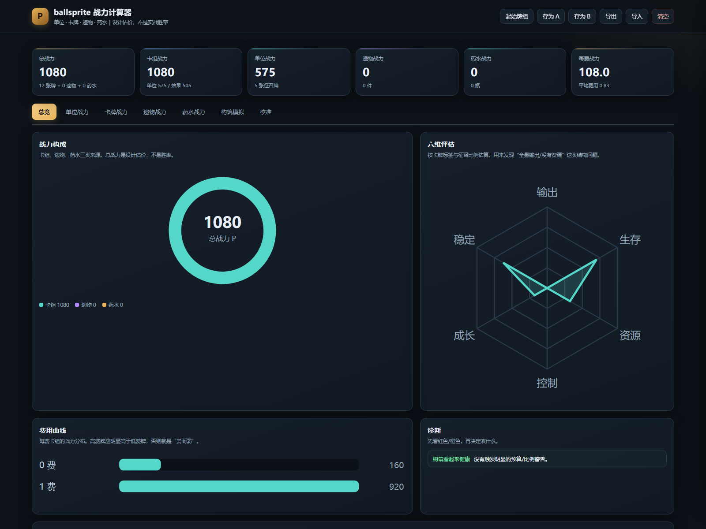
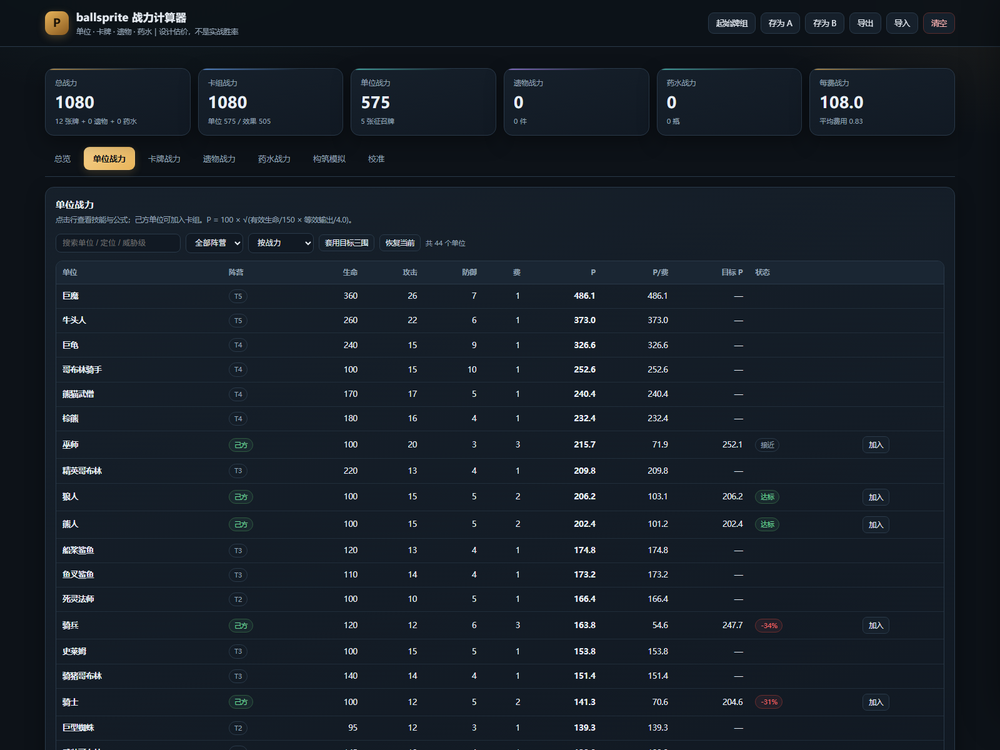

# 战力计算器使用说明

> 配套文件：[战力计算器.html](战力计算器.html)  
> 设计总纲：[数值框架与全量数值.md](数值框架与全量数值.md)  
> 版本：CALC-v1.0｜日期：2026-10-18

---

## 1. 它是什么

一个**单文件、离线、双击即开**的 HTML 计算器，把单位、卡牌、遗物、药水放在同一把“战力 P”尺子上比较：

- 士兵 = **100 P**。
- 单位按生命、攻击、防御、闪避、技能倍率/冷却/段数/射程估。
- 卡牌按效果类型与系数估。
- 遗物按“每场触发次数 × 单次价值”估。
- 药水按“命中次数 × 伤害 × 目标数 + 功能价值”估。
- 卡组、遗物、药水可以组合成一套构筑，实时看总战力、每费战力、费用曲线、六维和诊断。

它不是战斗模拟器，**不能预测胜率**。它解决的是“这张牌/这个单位/这件遗物，按同一套预算看，是超模还是偏弱”。

> 旧的 `单位战力计算器.html` 只覆盖单位，且使用上一版 21 单位口径；本文件是新的四类统一计算器，旧文件仅作历史对照。





---

## 2. 怎么打开

1. 双击 `docs/数值设计/战力计算器.html`。
2. 推荐 Chrome / Edge / Firefox 最新版。
3. 不需要联网，不需要安装，不需要 Godot。
4. 数据、卡组、A/B 快照都保存在浏览器本地（localStorage），换浏览器/清缓存会丢失。

> 如果双击后被浏览器拦截脚本，右键 → 打开方式 → 选择浏览器；或把文件拖进浏览器窗口。

---

## 3. 界面结构

### 3.1 顶部

| 按钮 | 作用 |
| --- | --- |
| 起始牌组 | 恢复当前游戏的 12 张起始牌组（不含遗物/药水） |
| 存为 A / 存为 B | 保存当前构筑快照，用于对比 |
| 导出 | 把卡组、遗物、药水、手动修改、模型参数导出为 JSON |
| 导入 | 读取之前导出的 JSON |
| 清空 | 清空构筑、手动修改、A/B 快照（二次确认） |

### 3.2 六个指标卡

总战力、卡组战力、单位战力、遗物战力、药水战力、每费战力。  
如果存了 A，顶部会显示“当前 − A”的差值。

### 3.3 七个标签页

| 标签 | 看什么 |
| --- | --- |
| 总览 | 战力构成、六维、费用曲线、诊断、Top 8、A/B 对比 |
| 单位战力 | 44 个单位的三围、费用、P、P/费、目标 P、状态；点击行看技能/公式；可一键“套用目标三围” |
| 卡牌战力 | 61 张牌（50 效果 + 11 征召）的费用、P、强化 P、效率、标签；可一键“套用建议费用” |
| 遗物战力 | 66 件遗物的稀有度、触发、P/场、价格、流派、效果 |
| 药水战力 | 40 瓶药水的稀有度、价格、P、起始幕、目标、效果 |
| 构筑模拟 | 卡组数量、遗物、3 格药水带、诊断、总览、A/B |
| 校准 | 模型参数、卡牌系数、公式、数据版本、导入导出 |

---

## 4. 单位战力怎么算

### 4.1 公式

```text
有效生命 = 生命 × 15 / max(15 − 防御, 1) / (1 − 闪避 × 0.7)
DPS = 伤害 / 观察窗口 × 输出在线率
等效输出 = DPS + 治疗权重 × HPS
本体战力 = 100 × √(有效生命/150 × 等效输出/4.0)
总战力 = 本体战力 + 召唤贡献
```

默认参数：

| 参数 | 默认 | 含义 |
| --- | --- | --- |
| 观察窗口 | 12 秒 | 按 12 秒估 DPS |
| 单次施法占用 | 0.55 秒 | 技能动画/施法时间 |
| 参考目标防御 | 5 | 所有伤害按 5 防算 |
| 范围平均目标数 | 1.4 | 区域/冲刺平均命中 |
| 近战在线率 | 0.8 | 走路/被拉扯的折损 |
| 远程在线率 | 1.0 | 远程通常接近满输出 |
| 治疗权重 | 0.5 | HPS 折算成输出 |
| 基准有效生命 | 150 | 士兵默认 |
| 基准等效输出 | 4.0 | 士兵默认 |
| 基准战力 | 100 | 士兵 = 100 P |

### 4.2 技能排程

单位的所有已生效技能按 `优先级` 排序；每个技能有冷却和施法占用。计算器从 0 秒开始，每次选“当前可用且优先级最高”的技能，累加命中帧伤害，直到 12 秒窗口结束。  
多段技能按 `段数 × 每段伤害` 算；范围/冲刺按 1.4 个目标；治疗按 `攻击 × 倍率`；召唤按 50 P 的固定贡献（当前只用于死灵法师）。

### 4.3 训练

单位详情里的“训练后战力”默认把 `upgrade_points` 全部加攻击，并启用 `生效等级 1` 的技能。  
如果实际训练是加防御，或单位有分支技能（士兵斩击/飞弹），结果会不同；可以在“单位”页手动改三围模拟。

### 4.4 边界

- 移动速度、控制、地形、毒、死亡爆炸、幸存结算扣血**没有**折进 P。
- 隐身、瞬移接敌、上场抽牌、团队光环只部分计入；详情页会标注“未折分”。
- 多段攻击当前按“每段扣防御”算，和游戏现版本一致；如果改成“每技能扣一次防御”，单位 P 会明显上升（尤其是剑士）。
- 所以 P 是**比较工具**，不是绝对强度。

---

## 5. 卡牌战力怎么算

### 5.1 公式

```text
卡牌 P = Σ 每条效果的价值
效果价值 = 数值 × 系数 × 条件折损
费用预算 = 100 × 费用^0.8（0 费固定 100）
效率 = 卡牌 P / 费用预算
```

### 5.2 关键系数

| 效果 | 系数 | 说明 |
| --- | --- | --- |
| +1 攻击 | 25 P | 单体、本场 |
| +1 防御 | 30 P | 按有效生命提升 |
| 回复 1% 生命 | 1.5 P | 以 100 生命单位为参考 |
| 1 层中毒 | 20 P | 多段攻击会放大 |
| 1 点护盾 | 1.2 P | 只在交锋期有效 |
| 抽 1 张 | 40 P | 含手牌/费用成本 |
| +1 能量 | 65 P | 即时能量 |
| 1 秒眩晕 | 60 P | 硬控 |
| 1 点虚弱/破甲 | 25 P | 可叠加 |
| 1 点区域伤害/跳 | 16.9 P | 按 2 回合、1.4 目标估 |
| 1 点流血/秒 | 1.0 P | 按持续秒数 |
| 1 点玩家生命 | 2.5 P | 血契/事件付血 |

> 系数都在“校准”页可改。改系数会改变所有卡牌的排序；一次只改一个，并记录。

### 5.3 怎么读效率

| 效率 | 含义 | 建议 |
| --- | --- | --- |
| > 1.3 | 单卡超模 | 先实测，不要直接砍；检查触发条件是否太容易 |
| 1.0–1.3 | 强 | 可作为核心/稀有 |
| 0.6–1.0 | 正常 | 大多数牌 |
| 0.45–0.6 | 偏低 | 检查费用是否过高，或它是否为组合件 |
| < 0.45 | 明显偏低 | 治疗/护盾/控制可能被低估；否则考虑降费/加数值 |

**治疗、护盾、控制**的单体估价天然偏低：它们的价值取决于目标单位。看到“战地治疗 0.38”不要立刻加强，先问“它救的是不是 200 P 的核心单位”。

---

## 6. 遗物/药水战力怎么算

### 6.1 遗物

```text
遗物 P = 每场触发次数 × 单次触发价值 × 兑现率
```

- 被动光环：6 轮 × 覆盖率。
- 战斗开始/胜利：每场 1 次。
- 击杀/死亡/受击：每场 3–6 次。
- 商店/金币：每幕 1–2 次，再折成 P。

预算：普通 60–90、稀有 140–200、首领 300–420。

### 6.2 药水

```text
药水 P = 命中次数 × 每次伤害 × 平均目标数 × 1.2 + 功能价值
```

预算：普通 90–130、稀有 180–260、传说 350–500。

> 遗物/药水的 P 是设计估价，不是从游戏代码实时模拟。你可以在详情抽屉里覆盖 P，观察构筑总额变化。

---

## 7. 构筑模拟怎么用

### 7.1 加内容

- 卡牌页/单位页：点“加入”。
- 构筑页：下拉选择 + 加入。
- 遗物页：点“加入”（同一件不能重复）。
- 药水页：点“加入”（最多 3 瓶）。

### 7.2 调数量

构筑页每张牌右侧有 `− / 数字 / +`，也可以直接输入数量；0 等于移除。

### 7.3 看诊断

诊断会提示：

- 没有征召牌 / 征召比例 <30%。
- 平均费用 >2.2。
- 卡组 >30 或 <10。
- 超预算/低于预算的牌。
- 遗物 >10、药水 >3。

这些是“检查清单”，不是硬性规则。比如召唤流可以低征召比例，但要有其他铺场手段。

### 7.4 A/B 对比

1. 调好一套，点“存为 A”。
2. 改几张牌/遗物/数值。
3. 点“存为 B”。
4. 总览页或构筑页看 `B − A` 的差值。

差值按“总战力 / 卡组 / 单位 / 效果牌 / 遗物 / 药水 / 每费 / 卡牌数 / 平均费用”拆开，能看出变化来自哪里。

### 7.5 套用目标值

- 单位页：点 **“套用目标三围”**，11 个己方单位会变成设计文档第 5 节的目标值；再点“恢复当前”回到游戏现版本。
- 卡牌页：点 **“套用建议费用”**，16 张高费牌会变成第 6.6 节的建议费用；再点“恢复当前”回到现费用。
- 这两个按钮只改计算器里的本地副本，不会改游戏资源。适合回答“如果按设计稿调完，构筑会强多少”。

---

## 8. 校准页怎么用

### 8.1 模型参数

- 改 `观察窗口`、`施法占用`、`参考防御`、`在线率`、`治疗权重`、`基准值`。
- 改 `1 能量 = ? P`、`1 抽牌 = ? P`、`1 玩家生命 = ? P`。
- 修改后会立刻重算全部单位/卡牌。

### 8.2 卡牌系数

- 改 `+1 攻击`、`+1 防御`、`抽 1 张`、`+1 能量` 等系数。
- 用来回答“如果我认为 1 点攻击更值钱，排序会怎么变”。

### 8.3 恢复默认

点“恢复默认”会回到 `design_data.json` 里的初始模型，不会改游戏资源。

### 8.4 导出/导入

- 导出：下载 `ballsprite-战力方案.json`。
- 导入：选择之前导出的 JSON，覆盖当前状态。
- 导出包含：卡组、遗物、药水、手动改过的单位/卡牌/遗物/药水数值、模型参数、A/B 快照。

---

## 9. 数据来源与更新

计算器的数据由 `docs/数值设计/support/design_data.py` 从当前 Godot 资源生成：

- `data/units/*.tres`：单位三围、费用、技能。
- `data/skills/*.tres`：倍率、冷却、射程、命中帧。
- `data/cards/*.tres`：费用、稀有度、效果。
- `data/relics/*.tres` + `docs/遗物流派设计.md`：66 件遗物。
- `data/potions/*.tres` + `docs/药水能力设计与投放方案.md`：40 瓶药水。
- `data/levels/*.tres` + `data/levels/第一章 ·  翠绿原野.json`：关卡与路线。
- `data/shops/caravan.json`：商店价格。

更新流程：

```powershell
python docs/数值设计/support/design_data.py
python docs/数值设计/support/build_calculator.py
```

第一条会重读项目资源并重算 `design_data.json`；第二条把数据和应用注入 HTML。  
如果你只改 HTML/JS，不重跑第一条也可以，但数据不会更新。

---

## 10. 限制与常见问题

**Q：为什么和游戏里打出来的伤害不一样？**  
A：计算器按 12 秒窗口、5 防目标、1.4 个范围目标估，不模拟走位、动画打断、目标选择、过量伤害和随机牌序。

**Q：为什么剑士 P 这么低？**  
A：因为当前版本多段攻击每段都扣防御，六连刺 7 段打 5 防目标每段只有 1 点。计算器如实反映这个问题；这也是设计文档建议改伤害公式的原因。

**Q：为什么治疗/护盾效率这么低？**  
A：单体估价把治疗量直接折成 P，没有把“救下核心单位”的间接价值算满。看这类牌时，先看它救的是谁。

**Q：为什么遗物/药水不能改效果？**  
A：它们的效果不是结构化公式，计算器只让改 P 覆盖值。要改效果文本，去 `.tres` 或设计文档。

**Q：数据会丢吗？**  
A：会。localStorage 跟浏览器/域名绑定；清缓存、换浏览器、换电脑都会丢。重要方案请“导出”。

**Q：能多人共用吗？**  
A：可以。把 HTML + 导出的 JSON 发给对方；对方打开 HTML 后导入即可。

**Q：手机上能用吗？**  
A：能。布局会变成单列，表格横向滚动；建议横屏。

---

## 11. 一页操作流程

1. 双击打开。
2. 点“起始牌组”。
3. 卡牌页加 3–4 张想试的牌。
4. 遗物页加 3–5 件同流派遗物。
5. 药水页加 1–3 瓶。
6. 看总览诊断：有没有缺征召、费用太高、超预算。
7. 存 A → 改一张牌/一个单位 → 存 B → 看差值。
8. 导出 JSON，记下版本号。
9. 进游戏试玩 10 场，回来改计算器，再重复。

---

## 12. 文件清单

| 文件 | 作用 |
| --- | --- |
| `战力计算器.html` | 单文件计算器（数据 + 界面 + 逻辑） |
| `数值框架与全量数值.md` | 设计总纲与全量数值 |
| `support/design_data.json` | 计算器数据源 |
| `support/design_data.py` | 从游戏资源生成数据 |
| `support/build_calculator.py` | 把数据注入 HTML |
| `support/calculator_template.html` | HTML/CSS 模板 |
| `support/calculator_app_part*.js` | 计算器逻辑源码（合并后注入） |

---

*这份计算器的目标是让你“看见”数值，而不是替你做平衡决定。最终以试玩为准。*
